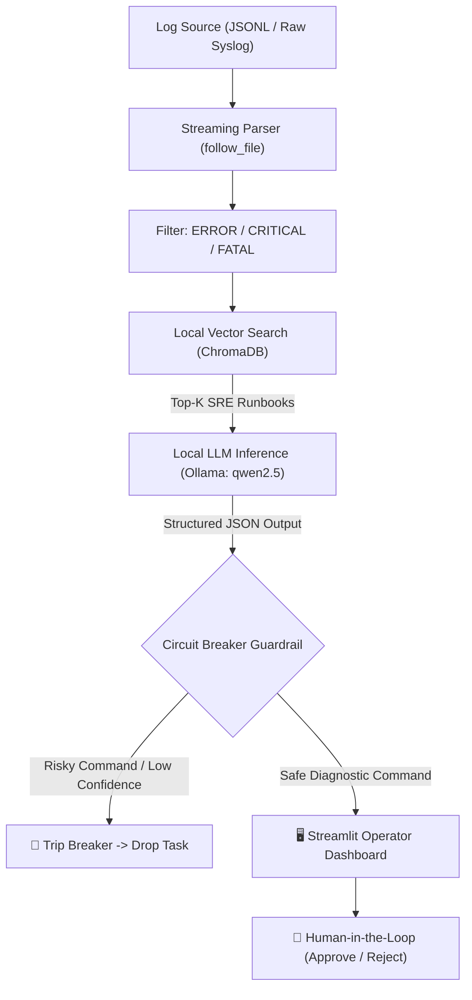

# 🛡️ Autonomous AIOps Incident Remediation & Log Parser Engine

[](https://www.python.org/downloads/)
[](https://www.trychroma.com/)
[](https://ollama.com/)
[](https://streamlit.io/)
[](LICENSE)

An **air-gapped, human-in-the-loop AIOps engine** that streams server logs, retrieves relevant SRE runbooks using local **ChromaDB** vector search, and generates structured diagnostic recommendations using a local **Ollama** LLM. 

Equipped with a deterministic **Fail-Closed Circuit Breaker** to guarantee that autonomous AI agents **never execute dangerous shell commands** on production infrastructure.

---

## 🎯 The Problem This Solves

1. **High MTTR (Mean Time to Resolution):** On-call engineers waste 30–60 minutes searching for runbooks during late-night outages. This engine matches error logs to SRE playbooks in milliseconds.
2. **The "Rogue Agent" Catastrophe:** Autonomous AI agents with terminal access can hallucinate destructive commands (`rm -rf`, modifying firewalls, restarting active databases). This engine enforces **Human-in-the-Loop** approval with hardcoded command safety blacklists.
3. **Data Privacy & Compliance:** Cloud LLMs expose proprietary server logs and IPs. This system runs **100% on-premises / air-gapped** using Ollama and ChromaDB.

---

## 🏗️ System Architecture



---

## ✨ Key Features

* **100% Local & Air-Gapped:** Zero external cloud dependencies. No Pinecone API keys required. Embeddings (`nomic-embed-text`) and inference (`qwen2.5:7b`) run on localhost.
* **Deterministic Circuit Breaker Guardrail:**
  * Blacklists high-risk commands (`rm`, `chmod`, `sudo`, `dd`, `kill`, `eval`, etc.).
  * Disallows shell chaining and subshells (`;`, `&&`, `|`, `` ` ``, `$()`).
  * Enforces minimum confidence thresholds and boolean validation flags (`diagnosis`, `runbook_support`, `command_safety`).
  * Trips into an **Open (Safe)** state on violations until manually inspected and reset.
* **Interactive Streamlit Dashboard:** Complete incident triage simulator with one-click scenarios, live confidence meters, runbook viewers, and an operator audit trail.
* **Dual Ingestion Engine:** Supports real-time file following (`tail -f` style) and one-shot JSONL/Syslog parsing.

---

## 🚀 Quickstart

### 1. Prerequisites
* Python 3.10+
* (Optional for live LLM inference) [Ollama](https://ollama.com/) running locally:
  ```bash
  ollama pull qwen2.5:7b
  ollama pull nomic-embed-text
  ```
  *(Note: The Streamlit UI includes a built-in simulation fallback, so you can test all features even without Ollama running!)*

### 2. Install Dependencies
```powershell
python -m venv .venv
.\.venv\Scripts\Activate.ps1
pip install -r requirements.txt
```

### 3. Launch the Interactive Streamlit UI
```powershell
streamlit run app.py
```
Open your browser to `http://localhost:8501`.

### 4. (Optional) Run the FastAPI Ingestion Webhook
Allow external microservices (Node.js, Python, Spring Boot) to push logs over HTTP:
```powershell
uvicorn api:app --reload --port 8000
```
View interactive Swagger docs at `http://localhost:8000/docs`.

---

## 💻 CLI Usage

### Index SRE Runbooks into ChromaDB
```powershell
python aioops_engine.py --sync-runbooks
```

### Process Sample Logs in One-Shot Mode
```powershell
python aioops_engine.py --log-file samples/server.jsonl --once
```

### Follow a Live Server Log
```powershell
python aioops_engine.py --log-file C:\path\to\server.log --from-end
```

---

## 🧪 Running Unit Tests

The test suite validates parser edge cases, circuit breaker tripping, high-risk command blocking, subshell injection prevention, and vector retrieval:

```powershell
python -m unittest discover -s tests
```

---

## 🐳 Docker Deployment

To build and run the containerized Streamlit dashboard:

```bash
docker build -t aioops-engine .
docker run -p 8501:8501 aioops-engine
```

---

## 📂 Project Structure

```text
├── core/
│   ├── parser.py          # Log stream follower & multi-format parser
│   ├── guardrails.py      # Circuit Breaker & command blacklist engine
│   ├── llm_client.py      # Local Ollama client with JSON Schema enforcement
│   └── vector_store.py    # Local ChromaDB runbook vector store
├── aioops_engine.py       # Core CLI orchestrator & event processor
├── app.py                 # Streamlit SRE Operator Dashboard
├── runbooks.jsonl         # SRE operational playbooks
├── samples/
│   └── server.jsonl       # Sample incident logs
├── tests/
│   └── test_aioops_engine.py  # Unit test suite
├── Dockerfile             # Production container definition
├── requirements.txt       # Project dependencies
└── README.md              # Project documentation
```

---

## 📜 Repository Guidelines

- Inference is kept strictly local and text-only.
- All AI recommendations require human operator review; commands are never executed autonomously.
- Run `python -m unittest discover -s tests` after any engine modifications.
