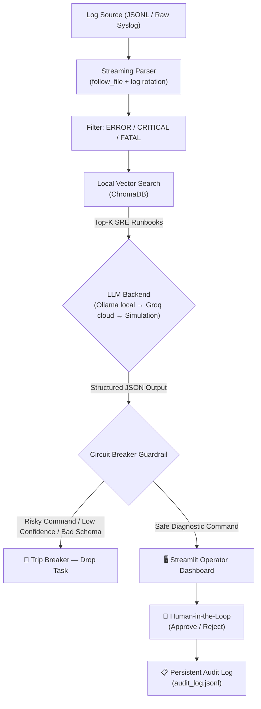

# 🛡️ Autonomous AIOps Incident Remediation & Log Parser Engine

<p align="center">
  <a href="https://autonomous-aioops.streamlit.app"></a>
</p>

<p align="center">
  
  
  
  
  
  
  
  
  
</p>

---

An **air-gapped, human-in-the-loop AIOps engine** that streams server logs, semantically retrieves relevant SRE runbooks via **ChromaDB** vector search, and generates structured diagnostic recommendations using a local **Ollama** LLM or **Groq Cloud** — with zero commands ever executed autonomously.

A deterministic **Fail-Closed Circuit Breaker** guarantees that no AI-generated shell command ever touches production infrastructure without explicit human approval.

---

## 🎯 The Problem This Solves

| Pain Point | How This Engine Solves It |
|---|---|
| **High MTTR** — On-call engineers waste 30–60 min searching runbooks during outages | Semantic vector search matches error logs to SRE playbooks in milliseconds |
| **Rogue AI Agents** — LLMs can hallucinate `rm -rf`, firewall changes, DB restarts | Deterministic circuit breaker with command blacklists and shell-injection guards |
| **Data Privacy / Compliance** — Cloud LLMs expose proprietary server logs and IPs | Fully local mode (Ollama + ChromaDB) — zero data leaves the host |

---

## 🏗️ System Architecture



---

## ✨ Key Features

### 🔒 Deterministic Fail-Closed Circuit Breaker
The core safety guarantee of this system. No code path ever executes a command — the breaker ensures risky outputs are dropped before reaching an operator.

- **Blacklists 20+ high-risk command tokens** (`rm`, `chmod`, `sudo`, `dd`, `kill`, `eval`, `mkfs`, `iptables`, `fdisk`, etc.)
- **Blocks all shell chaining and injection** (`;`, `&&`, `||`, `|`, `` ` ``, `$()`, redirections)
- Uses **`shlex` token-level parsing** — catches `bash -c "rm -rf /tmp"` style bypasses that regex alone misses
- Rejects **non-finite confidence values** (`NaN`, `Inf`) from malformed LLM outputs
- Validates required boolean flags: `diagnosis`, `runbook_support`, `command_safety` — all must be `True`
- Trips into **Open (blocked) state** on any violation — stays open until a human manually resets it

### 🧠 Dual LLM Backend (Local → Cloud → Simulation)
Seamlessly falls back across three modes with no code change:

| Mode | When Active | Privacy |
|---|---|---|
| **Ollama** (local) | Ollama daemon reachable on `localhost` | 100% air-gapped |
| **Groq Cloud** | Ollama offline + API key configured | Logs sent to Groq |
| **Simulation** | Both offline | Static deterministic responses |

### 📚 Semantic Runbook Retrieval (RAG)
- **8 production SRE runbooks** indexed in ChromaDB: `DB_POOL_EXHAUSTED`, `HTTP_502`, `OOM_KILL`, `DISK_FULL`, `TLS_CERT_EXPIRED`, `CPU_THROTTLE`, `REDIS_CONN_REFUSED`, `KAFKA_LAG`
- Cosine-similarity vector search with **local fallback** (no ChromaDB binary required)
- JSON Schema enforcement on LLM outputs via Ollama's native `format` parameter

### 🔄 Robust Log Ingestion
- **Real-time file following** (`tail -f` style) with **log rotation detection** (inode change + truncation)
- **Multi-format parsing**: structured JSONL and raw syslog text
- **FastAPI webhook** for external services (Node.js, Python, Spring Boot, Go) to push logs over HTTP

### 📋 Persistent Operator Audit Trail
Every approval and rejection is written to `audit_log.jsonl` and survives page refreshes — giving a full compliance-ready record of operator decisions.

---

## 🧰 Tech Stack

| Component | Technology | Purpose |
|---|---|---|
| Core Engine | Python 3.10+ | Log parsing, orchestration, guardrails |
| Vector Store | ChromaDB | Local semantic runbook search |
| Local LLM | Ollama (`qwen2.5:7b`) | Air-gapped inference |
| Cloud LLM | Groq (`llama-3.1-8b-instant`) | Low-latency cloud fallback |
| Embeddings | Ollama (`nomic-embed-text`) | Local text embeddings |
| Dashboard | Streamlit | SRE operator UI |
| REST API | FastAPI + Pydantic | External log ingestion webhook |
| Containerization | Docker | Production deployment |
| Testing | Python `unittest` + `unittest.mock` | 15 unit tests |

---

## 🚀 Quickstart

### 1. Clone & Install

```bash
git clone https://github.com/PiyushAgarwalcs/Autonomous-AlOps-Incident-Remediation-Log-Parser-Engine.git
cd Autonomous-AlOps-Incident-Remediation-Log-Parser-Engine

python -m venv .venv
# Windows:
.\.venv\Scripts\Activate.ps1
# macOS/Linux:
source .venv/bin/activate

pip install -r requirements.txt
```

### 2. Configure (Optional — for local LLM mode)

```bash
# Install Ollama from https://ollama.com, then:
ollama pull qwen2.5:7b
ollama pull nomic-embed-text
```

> **No Ollama?** The app falls back to Groq Cloud (configure your key in `.streamlit/secrets.toml`) or runs in simulation mode — all features are demonstrable without any local setup.

### 3. Launch the Streamlit Dashboard

```bash
streamlit run app.py
```

Open `http://localhost:8501` in your browser.

### 4. (Optional) Run the FastAPI Ingestion API

```bash
uvicorn api:app --reload --port 8000
```

Interactive API docs available at `http://localhost:8000/docs`.

---

## 💻 CLI Usage

```bash
# Index SRE runbooks into local ChromaDB
python aioops_engine.py --sync-runbooks

# Analyze a log file once and exit
python aioops_engine.py --log-file samples/server.jsonl --once

# Follow a live log file (tail -f with rotation detection)
python aioops_engine.py --log-file /var/log/app.log --from-end

# Full options
python aioops_engine.py --help
```

All output is newline-delimited JSON (NDJSON), suitable for piping into Elasticsearch, Loki, or any log aggregator.

---

## 🔌 External Integration

Push logs from any service directly into the engine via the REST API:

```bash
# cURL
curl -X POST http://localhost:8000/ingest \
  -H "Content-Type: application/json" \
  -d '{"level": "ERROR", "service": "payments-api", "error_code": "DB_POOL_EXHAUSTED", "message": "Connection pool timeout after 30s"}'
```

```python
# Python
import requests
requests.post("http://localhost:8000/ingest", json={
    "level": "ERROR", "service": "payments-api",
    "error_code": "DB_POOL_EXHAUSTED", "message": "Connection pool timeout"
})
```

```javascript
// Node.js / Express
await axios.post('http://localhost:8000/ingest', {
  level: 'ERROR', service: 'payments-api', message: err.message
});
```

---

## 🐳 Docker

```bash
docker build -t aioops-engine .
docker run -p 8501:8501 aioops-engine
```

The image uses `python:3.10-slim`, includes a `HEALTHCHECK`, and exposes port `8501`.

---

## 🧪 Tests

```bash
python -m unittest discover -s tests -v
```

**20 tests covering:**
- JSONL and raw syslog parsing
- Circuit breaker: low confidence, NaN, `bash -c "rm -rf"` injection, shell chaining, reset lifecycle
- `OllamaClient` localhost-only enforcement
- `GroqClient` validation and markdown code fence stripping
- FastAPI webhook endpoints (`/health`, `/ingest` validation)
- ChromaDB cosine similarity and vector search
- `follow_file` real-time tailing (`from_end=True` skip, existing-line reading)

---

## 📂 Project Structure

```
├── core/
│   ├── parser.py          # Log stream follower, rotation detection & multi-format parser
│   ├── guardrails.py      # Fail-Closed Circuit Breaker & command safety engine
│   ├── llm_client.py      # Local Ollama client with JSON Schema enforcement
│   ├── groq_client.py     # Groq Cloud LLM client (OpenAI-compatible)
│   └── vector_store.py    # ChromaDB runbook vector store with local fallback
├── aioops_engine.py       # CLI orchestrator — log tail → RAG → LLM → guardrail
├── app.py                 # Streamlit SRE Operator Dashboard
├── api.py                 # FastAPI log ingestion webhook
├── runbooks.jsonl         # 8 SRE operational playbooks
├── samples/
│   └── server.jsonl       # Sample incident logs for testing
├── tests/
│   └── test_aioops_engine.py  # 15 unit tests
├── Dockerfile             # Production container
└── requirements.txt       # Python dependencies
```

---

## 🔐 Security Design

| Concern | Mitigation |
|---|---|
| LLM hallucinating destructive commands | Circuit breaker with token-level `shlex` scan + regex blacklist |
| Shell injection via `bash -c "..."` | Each `shlex` token is individually scanned, not just the full string |
| Non-finite confidence scores | `math.isfinite()` check rejects `NaN` and `Inf` from the LLM |
| External Ollama endpoint | `OllamaClient` raises `ValueError` if URL is not `localhost` / `127.0.0.1` |
| Log data leaving the host | Local-first architecture; Groq mode is opt-in with explicit key configuration |
| API key exposure to users | Key read from `st.secrets` (server-side only) — never sent to the browser |

---

## 🗺️ Known Limitations & Future Work

- **Circuit breaker state is per-process** — not shared across multiple `uvicorn` workers. A Redis-backed distributed breaker would be needed for multi-worker deployments.
- **Runbook set is small** — 8 runbooks covers common scenarios. A production deployment would ingest from a full Confluence/PagerDuty runbook export.
- **Audit log is local** — `audit_log.jsonl` is local to the deployment. A production setup would stream to an append-only audit database.

---

## 📜 Repository Guidelines

- Inference is kept strictly **local and text-only**.
- All AI recommendations require **human operator review** — commands are never executed autonomously.
- Run `python -m unittest discover -s tests` after any engine modifications.
